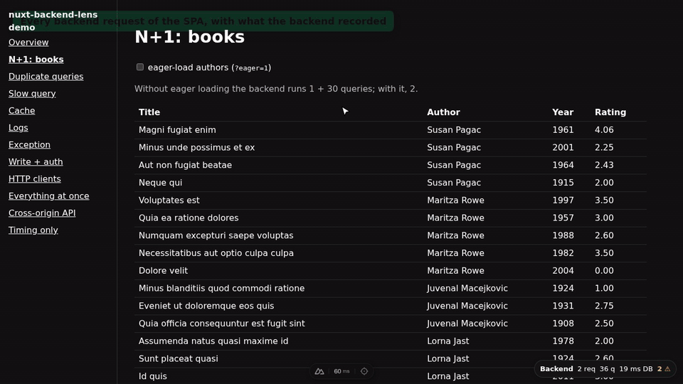

# nuxt-backend-lens

A Debugbar-like panel for Nuxt SPAs. For every request a page makes to the backend, it shows the
SQL, logs, cache events and timing the backend recorded, flags N+1 queries and duplicates, and
links each request to the click that caused it. All of it right on the page, in Nuxt DevTools, and
on the Vue DevTools timeline.



When Nuxt serves the HTML, Laravel Debugbar cannot inject its panel, and the browser's Network tab
has no SQL. `nuxt-backend-lens` reads the debug id the backend puts on each response and loads that
request's record from the backend's own debug package.

| Source                                                                 | How the record is found |
|------------------------------------------------------------------------|-------------------------|
| [Clockwork](https://github.com/itsgoingd/clockwork)                     | `X-Clockwork-Id` (+ `X-Clockwork-Path`) → `/__clockwork/{id}` |
| [Laravel Debugbar](https://github.com/fruitcake/laravel-debugbar)       | `phpdebugbar-id` → `/_debugbar/open?op=get&id={id}` |
| any backend sending `Server-Timing`                                     | the header itself (timing only) |
| anything else                                                          | [a custom adapter](https://github.com/DmitrySkibitsky/nuxt-backend-lens/blob/main/docs/adapters.md) |

Clockwork and Debugbar both work under Laravel Octane (verified with concurrent load on FrankenPHP).

> **Status**: early development. The API may change.

## Quick start

1. A debug package on the backend, dev only:

   ```bash
   composer require --dev itsgoingd/clockwork        # CLOCKWORK_ENABLE=true
   # or
   composer require --dev fruitcake/laravel-debugbar # DEBUGBAR_OPEN_STORAGE=true
   ```

2. The debug paths proxied next to `/api` (same origin), or CORS set up for them:
   [Getting started](https://github.com/DmitrySkibitsky/nuxt-backend-lens/blob/main/docs/getting-started.md).

3. The module:

   ```bash
   pnpm add -D nuxt-backend-lens
   ```

   ```ts
   // nuxt.config.ts
   export default defineNuxtConfig({
     $development: {
       modules: ['nuxt-backend-lens'],
     },
   })
   ```

A **Backend** badge appears in the bottom-right corner; click it to open the panel.

## Features

- **Every HTTP client**: `$fetch`, `useFetch`, nuxt-auth-sanctum, axios, `fetch`, XHR. Response bodies
  are never read.
- **Per request**:
  - queries with call sites (`app/Http/Resources/BookResource.php:29`), SQL highlighting and
    optional formatting (`sql.format`);
  - logs, cache events, exceptions;
  - a timeline with every query on the request's time axis.
- **Issues**:
  - N+1 and duplicate queries, collapsed into their first query and opened right below it;
  - slow queries;
  - repeated HTTP requests on one screen.
- **Actions**: requests grouped under the click or submit that caused them. Labels come from markup
  only, never from typed values.
- **Nuxt DevTools tab** with DevTools' look and colour mode, and a **Vue DevTools timeline** layer,
  both in `nuxt dev`.
- **Staging builds**: enabled at build time (`enabled: process.env.BACKEND_LENS === '1'`); when off,
  the bundle has no trace of it.

## Documentation

- [Getting started](https://github.com/DmitrySkibitsky/nuxt-backend-lens/blob/main/docs/getting-started.md):
  backend packages, same origin or CORS, staging builds, security
- [Features](https://github.com/DmitrySkibitsky/nuxt-backend-lens/blob/main/docs/features.md)
- [Configuration](https://github.com/DmitrySkibitsky/nuxt-backend-lens/blob/main/docs/configuration.md):
  every option
- [Adapters](https://github.com/DmitrySkibitsky/nuxt-backend-lens/blob/main/docs/adapters.md):
  the normalized model, writing your own
- [Architecture](https://github.com/DmitrySkibitsky/nuxt-backend-lens/blob/main/docs/architecture.md)
- [Development](https://github.com/DmitrySkibitsky/nuxt-backend-lens/blob/main/docs/development.md)
- [Troubleshooting](https://github.com/DmitrySkibitsky/nuxt-backend-lens/blob/main/docs/troubleshooting.md)

## Security

Debug records contain real data: SQL bindings, session contents, headers. Laravel Debugbar even
stores `APP_KEY` in clear. Use the module and the backend packages in development, or on gated
staging servers with short retention. Never use them in production.

## License

MIT
